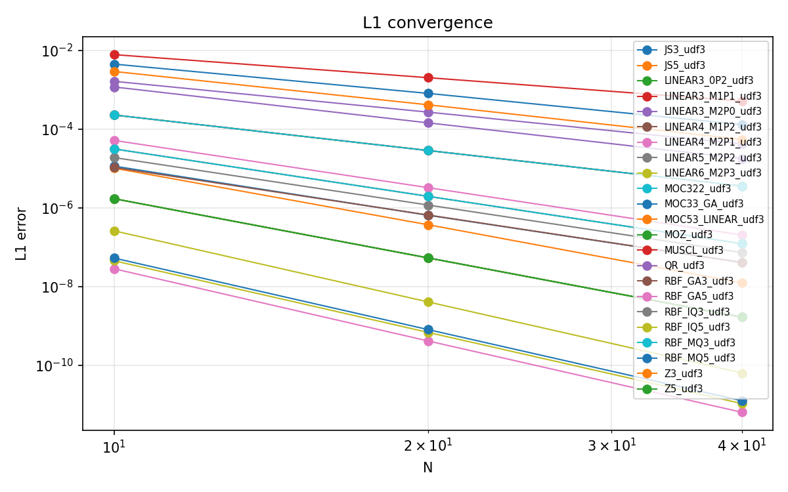
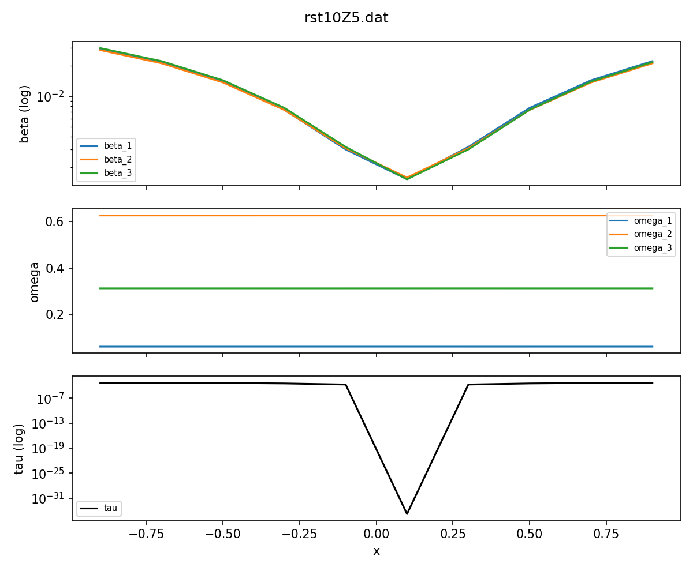

# WCNS 非线性插值精度测试 / WCNS Nonlinear Interpolation Accuracy Test

本仓库是 **WCNS（Weighted Compact Nonlinear Scheme）研究中的非线性插值精度测试程序**。
它测试半节点插值算子 `u_{j+1/2}` 的精度、收敛阶和非线性误差，不包含完整 WCNS
求解器的通量分裂与紧致差分步骤。

This repository is a **WCNS nonlinear interpolation accuracy test program**.
It measures the accuracy, convergence order, and nonlinear error of the
half-point interpolation operator `u_{j+1/2}`; it is not a WENO flux
reconstruction code and does not include the full WCNS flux-splitting and
compact-difference steps.

---

## 中文

### 项目简介

程序在 `[-1, 1]` 上逐级加密网格，对每种插值格式统计 L1/L2/L∞ 误差与收敛阶，
并计算非线性误差和权/光滑因子诊断量。插值模块放在
`src/interpolation/`，测试驱动放在 `src/test/`；后续标量方程、一维/二维
Euler 仓库可以整目录复用 `src/interpolation/`。

### 测试方法

- 网格：`N = ini_mesh_num * 2^(i-1)`，`i = 1..iter_times`；默认从 10 到 5120。
- 误差：`L1 = mean |u_exact - u_interp|`，`L2 = sqrt(mean (...)^2)`，
  `Linf = max |...|`；收敛阶 `p = log2(e_{i-1}/e_i)`。
- 非线性误差：`En = |u_interp - u_linear^p|`，其中 `u_linear^p` 是与被测格式
  **同阶**的纯线性插值（2/3/5/6 阶）。默认 `nonlinear_baseline = 'same_order'`；
  `'poly3'` 仅用于复现旧版固定三阶背景的结果。
- 诊断量：`beta`、`omega`、`tau`、`beta_L/beta_N`、`omega_L/omega_N`、
  `lambda_h2`、`h_noscale`；由格式例程的可选 `diag` 参数返回。

### 保留格式

| Scheme ID | 类别 | 阶数 | 说明 |
|-----------|------|------|------|
| `MUSCL` | 低阶基线 | 2 | minmod 限制器 |
| `JS3` / `Z3` | JS/Z 型非线性加权插值 | 3 | 三点模板 |
| `JS5` / `Z5` | JS/Z 型非线性加权插值 | 5 | 五点模板 |
| `QR` | 类有理分式 | 3 | quasi-rational |
| `MOC322` | 文献 [3] 的三阶 MOC 方法 | 3 | 主候选 + 两个二阶候选 |
| `MOC33` | 文献 [4] 的三阶混合框架 | 3 | 线性/RBF + QR |
| `MOC53` | 五阶混合框架（暂未发表） | 5 | 五点线性/RBF + 三点 QR |
| `MOZ` | 文献 [1] 的改进五阶 Z 型加权 | 5 | 原 `MOZ_mml`，去掉 mml 后缀 |
| `LINEAR3_M1P1` 等 | 线性 | 3 | 3 阶各模板变体 |
| `LINEAR4_M2P1` 等 | 线性 | 4 | 4 阶各模板变体 |
| `LINEAR5_M2P2` | 线性 | 5 | 五点对称模板 |
| `LINEAR6_M2P3` | 线性 | 6 | 六阶模板 |
| `RBF_GA3` / `RBF_MQ3` / `RBF_IQ3` | RBF 扰动 | 3 | GA/MQ/IQ |
| `RBF_GA5` / `RBF_MQ5` / `RBF_IQ5` | RBF 扰动 | 5 | GA/MQ/IQ |

`MOC33`/`MOC53` 的输出文件名会追加线性候选后缀，例如 `MOC53_GA`；
RBF 的导数类型由 `rbf_num_deriv`、`rbf_denom_deriv` 控制。

### 构建与运行

```bash
make                 # 默认 Intel ifx
make test            # 运行全部测试
make smoke           # 端到端烟测
make run             # 按 input.nml 运行
make FC=gfortran     # 可选的 gfortran 构建
```

Windows 下使用 `build.bat`（ifx）。

### 精度选择

默认四精度（qp）。双精度版本：

```bash
make PRECISION=dp
make test PRECISION=dp
make PRECISION=qp     # 恢复默认
```

构建产物在 `build/$(PRECISION)/` 与 `bin/$(PRECISION)/`，两种精度互不混用。
提交的 `results/` 由 qp 生成；dp 用于快速验证/对照，高分辨率算例的测试阈值按精度放宽。

### 输入

`input.nml` 分为两组：

```fortran
&test_nml
  ini_mesh_num = 10, iter_times = 10,
  test_func_type = 3, n_order_critical_point = 1, udf_id = 3,
  nonlinear_baseline = 'same_order', output_fig = .true.,
/
&scheme_nml
  scheme = 'LINEAR3_M1P1',
/
```

`test_func_type`：1 临界点，2 标准波，3 UDF，4 omega 偏移。
`udf_id`：1..5 对应 `udf_1..udf_5`，6 对应无编号 `udf`；默认 `udf_id=3`（cos）。
所有格式参数及默认值见 `docs/formula_audit.md`。

### 结果

- `results/convergence/`：收敛阶 CSV、日志、误差-网格图（PNG）。
- `results/diagnostics/`：代表性 beta/omega 分布图。
- `results/samples/`：一个小网格 Tecplot 场数据样例。

快速复现：

```bash
make
sh scripts/run_results.sh --quick
python3 scripts/plot_convergence.py --quick
```

当前提交的 `results/` 是全格式快速矩阵：`sh scripts/run_results.sh --quick-matrix`
会重新生成 23 个 scheme × `udf3` × 3 次加密的 CSV/日志/小样本；
`python3 scripts/plot_convergence.py --quick` 和
`python3 scripts/plot_diagnostics.py --quick` 重新生成收敛阶图和
beta/omega 诊断图。

<!-- results-table -->
快速矩阵观测到的 L1 收敛阶（3 次加密，最后一对网格 N=20→40；仅作展示，不作验收门槛）：

| 格式 | 观测 L1 阶 |
|------|------------|
| MUSCL | 1.97 |
| JS3 | 2.63 |
| Z3 | 2.93 |
| QR | 2.69 |
| MOC322 | 3.00 |
| MOC33_GA | 3.99 |
| JS5 | 4.91 |
| Z5 | 5.00 |
| MOC53_LINEAR | 5.00 |
| MOZ | 5.00 |
| LINEAR5_M2P2 | 5.00 |
| LINEAR6_M2P3 | 6.00 |
| RBF_GA3 | 4.00 |
| RBF_GA5 | 6.02 |



代表性 beta/omega/tau 诊断图（Z5）：



### 公式来源与验收

数值公式依据作者已发表的工作：

1. Li H, Mao M, Yan Z-G, Zhu H, Bai J, Dong W, Deng X. A novel high-order nonlinear weighting with quasi-rational interpolation for capturing discontinuities. *Journal of Computational Physics*, 2026, 565: 115207. DOI: [10.1016/j.jcp.2026.115207](https://doi.org/10.1016/j.jcp.2026.115207)
2. 黎昊旻, 毛枚良, 白进维, 董维中, 朱华君. 非多项式高阶非线性加权格式研究综述. *空气动力学学报*, 2026, 44(1): 6-18. DOI: [10.7638/kqdlxxb-2025.0070](https://doi.org/10.7638/kqdlxxb-2025.0070)
3. 黎昊旻, 毛枚良, 燕振国, 朱华君, 白进维, 董维中. 基于多精度加权方法改进的三阶精度HWCNS格式. *空气动力学学报*, 2026, 网络首发. DOI: [10.7638/kqdlxxb-2025.0243](https://doi.org/10.7638/kqdlxxb-2025.0243)
4. 黎昊旻, 毛枚良, 燕振国, 刘庆宗, 白进维, 董维中. 基于类有理分式的强鲁棒性三阶精度激波捕捉格式研究. *空气动力学学报*, 2026, 网络首发（2026-11-19）. DOI: [10.7638/kqdlxxb-2026.0127](https://doi.org/10.7638/kqdlxxb-2026.0127)

其中 MOC53 框架的推导尚未发表，代码中作为完整实现一并提供；其五阶光滑因子部分见 [1]/[2]。逐格式的公式与实现选择见 `docs/formula_audit.md`。验收以逻辑正确为准：能编译、能跑完、收敛阶符合设计、临界点行为合理、无 NaN/崩溃、结果可复现。

欢迎从事 WCNS / 高精度非线性加权格式研究的同行共同探讨：haomin.li@buaa.edu.cn。

### 目录

```text
src/interpolation/   共享插值标准件（可选 diag）
src/test/            控制、测试函数、网格、solver、诊断、IO
app/main.f90         入口
tests/               Fortran 测试程序与 shell 检查
scripts/             结果生成与绘图
results/             收敛阶/诊断/小样本
docs/                方法说明与公式审计
```

### 许可证与联系方式

MIT License。版权归 Haomin Li 所有，见 `LICENSE`。联系方式：haomin.li@buaa.edu.cn。

---

## English

### Overview

This is a **WCNS nonlinear interpolation accuracy test** for the half-point
operator `u_{j+1/2}`. It refines the grid, computes L1/L2/L∞ errors and
convergence orders, and reports the nonlinear error and weight/smoothness
diagnostics. The interpolation modules live in `src/interpolation/` and are
designed to be copied into later scalar-equation and 1D/2D Euler repositories.

### Method

- Grid: `N = ini_mesh_num * 2^(i-1)`, `i = 1..iter_times`.
- Errors: `L1`, `L2`, `Linf` at half points; order `p = log2(e_{i-1}/e_i)`.
- Nonlinear error: `En = |u_interp - u_linear^p|`, where `u_linear^p` is the
  pure linear interpolation of the **same order** as the tested scheme.
  `nonlinear_baseline='same_order'` is the default; `'poly3'` is a
  compatibility mode for the old fixed third-order background.
- Diagnostics: `beta`, `omega`, `tau`, `beta_L/beta_N`,
  `omega_L/omega_N`, `lambda_h2`, `h_noscale`, returned through the optional
  `diag` argument.

### Schemes

| Scheme ID | Family | Order |
|-----------|--------|-------|
| `MUSCL` | minmod baseline | 2 |
| `JS3` / `Z3` | JS/Z nonlinear weighted interpolation | 3 |
| `JS5` / `Z5` | JS/Z nonlinear weighted interpolation | 5 |
| `QR` | quasi-rational | 3 |
| `MOC322` | 3rd-order MOC method [3] | 3 |
| `MOC33` | 3rd-order hybrid framework [4] | 3 |
| `MOC53` | 5th-order hybrid framework (unpublished) | 5 |
| `MOZ` | improved 5th-order Z-type weighting [1] | 5 |
| `LINEAR3_*` / `LINEAR4_*` / `LINEAR5_M2P2` / `LINEAR6_M2P3` | linear | 3/4/5/6 |
| `RBF_GA3` / `RBF_MQ3` / `RBF_IQ3` | RBF perturbed | 3 |
| `RBF_GA5` / `RBF_MQ5` / `RBF_IQ5` | RBF perturbed | 5 |

`MOC33`/`MOC53` output names include the linear-candidate suffix
(`MOC53_LINEAR`, `MOC53_GA`, ...).

### Build and run

```bash
make                 # Intel ifx (default)
make test
make smoke
make run
make FC=gfortran     # optional
```

On Windows use `build.bat` (ifx).

### Precision

The default is quad precision (qp). Build double precision with:

```bash
make PRECISION=dp
make test PRECISION=dp
make PRECISION=qp     # back to the default
```

Artifacts go to `build/$(PRECISION)/` and `bin/$(PRECISION)/`; the two precisions
never share objects. The committed `results/` are generated in qp; dp is for quick
checks and comparison, with high-resolution test thresholds relaxed accordingly.

### Input

`input.nml` has `&test_nml` and `&scheme_nml` groups. The test-function
selector is `test_func_type` (1 critical point, 2 standard wave, 3 UDF,
4 omega offset); `udf_id` selects 1..5 = `udf_1..udf_5`, 6 = unnumbered `udf`.
Exact scheme parameters and defaults are in `docs/formula_audit.md`.

### Results

`results/convergence/` holds convergence CSVs, logs, and L1 plots;
`results/diagnostics/` holds beta/omega plots; `results/samples/` holds one
small Tecplot field sample. Quick reproduction:

```bash
make
sh scripts/run_results.sh --quick
python3 scripts/plot_convergence.py --quick
```

The committed `results/` is the all-scheme quick matrix:
`sh scripts/run_results.sh --quick-matrix` regenerates 23 schemes × `udf3` ×
3 refinements (CSV/log/sample), and the two plotting scripts regenerate the
convergence and beta/omega diagnostic figures.

<!-- results-table -->
Observed L1 orders from the quick matrix (3 refinements; last pair N=20→40;
shown for orientation, not an acceptance gate):

| Scheme | Observed L1 order |
|--------|-------------------|
| MUSCL | 1.97 |
| JS3 | 2.63 |
| Z3 | 2.93 |
| QR | 2.69 |
| MOC322 | 3.00 |
| MOC33_GA | 3.99 |
| JS5 | 4.91 |
| Z5 | 5.00 |
| MOC53_LINEAR | 5.00 |
| MOZ | 5.00 |
| LINEAR5_M2P2 | 5.00 |
| LINEAR6_M2P3 | 6.00 |
| RBF_GA3 | 4.00 |
| RBF_GA5 | 6.02 |


Representative beta/omega/tau diagnostics (Z5):


### Formula source and acceptance

The numerical formulas follow the author's published work:

1. Li H, Mao M, Yan Z-G, Zhu H, Bai J, Dong W, Deng X. A novel high-order nonlinear weighting with quasi-rational interpolation for capturing discontinuities. *Journal of Computational Physics*, 2026, 565: 115207. DOI: [10.1016/j.jcp.2026.115207](https://doi.org/10.1016/j.jcp.2026.115207)
2. Li H, Mao M, Bai J, Dong W, Zhu H. A review of non-polynomial high-order nonlinear weighted schemes [in Chinese]. *Acta Aerodynamica Sinica*, 2026, 44(1): 6-18. DOI: [10.7638/kqdlxxb-2025.0070](https://doi.org/10.7638/kqdlxxb-2025.0070)
3. Li H, Mao M, Yan Z-G, Zhu H, Bai J, Dong W. An improved third-order HWCNS scheme based on multi-precision weighting [in Chinese]. *Acta Aerodynamica Sinica*, 2026, online first. DOI: [10.7638/kqdlxxb-2025.0243](https://doi.org/10.7638/kqdlxxb-2025.0243)
4. Li H, Mao M, Yan Z-G, Liu Q, Bai J, Dong W. A robust third-order shock-capturing scheme based on quasi-rational interpolation [in Chinese]. *Acta Aerodynamica Sinica*, 2026, online first (2026-11-19). DOI: [10.7638/kqdlxxb-2026.0127](https://doi.org/10.7638/kqdlxxb-2026.0127)

The MOC53 framework itself is not yet published and is included as a complete implementation; its five-point smoothness-indicator components follow [1]/[2]. Per-scheme formula and implementation choices are in `docs/formula_audit.md`. Acceptance is logical correctness: the code builds, runs through the refinement sequence, shows the designed orders, behaves sensibly at critical points, produces no NaN/crash, and its results are reproducible. Bitwise reproduction of published tables is not required.

WCNS researchers are welcome to discuss the methods: haomin.li@buaa.edu.cn.

### License and contact

MIT License. Copyright (c) 2026 Haomin Li; see `LICENSE`.
Contact: haomin.li@buaa.edu.cn.
